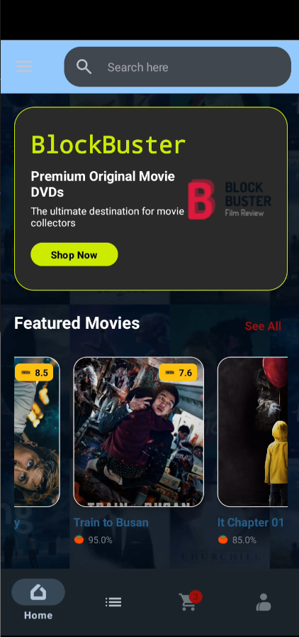
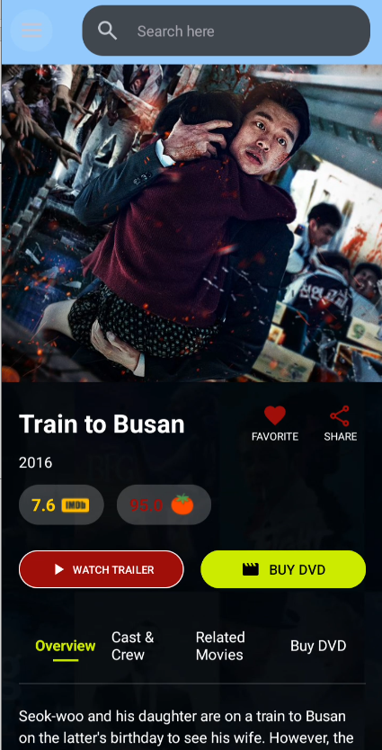
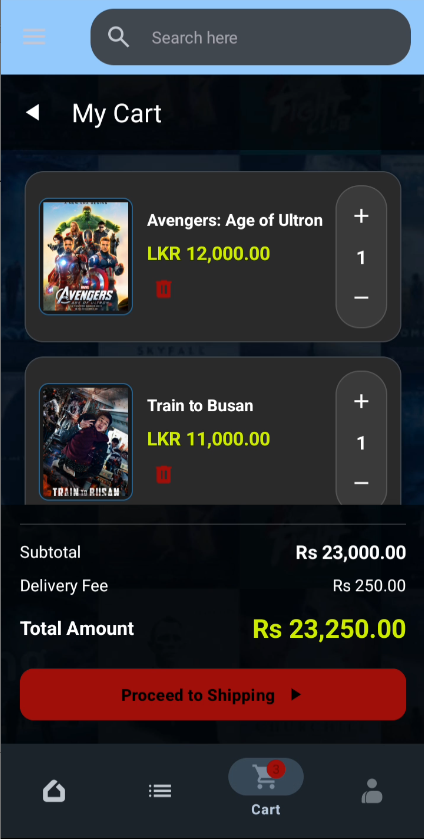
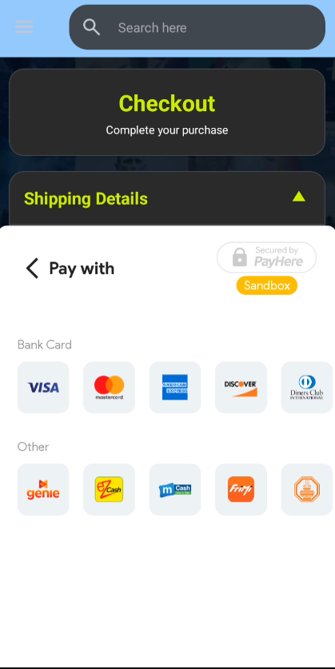
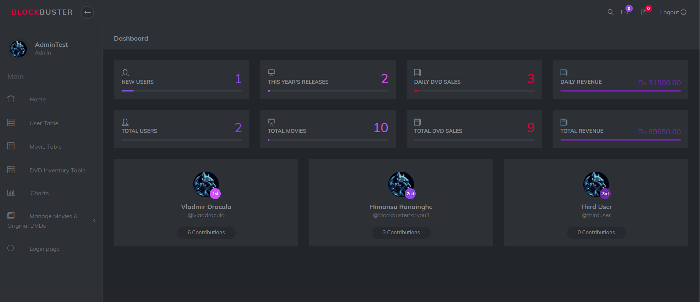
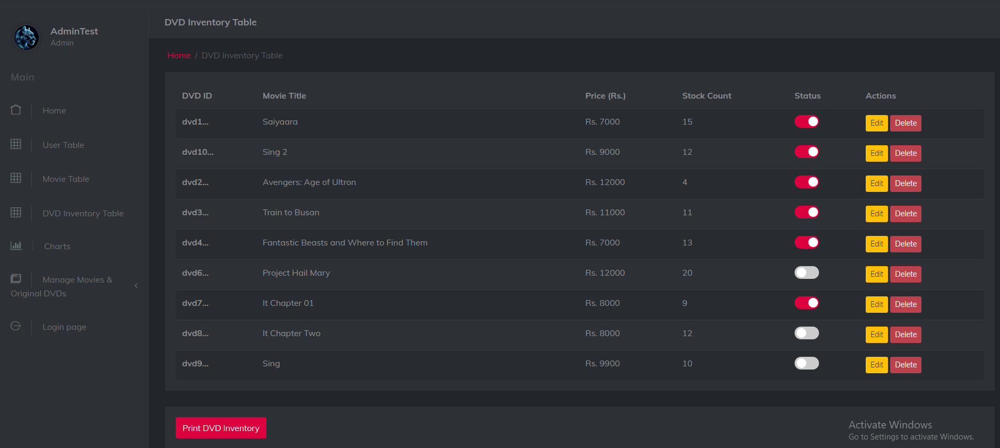
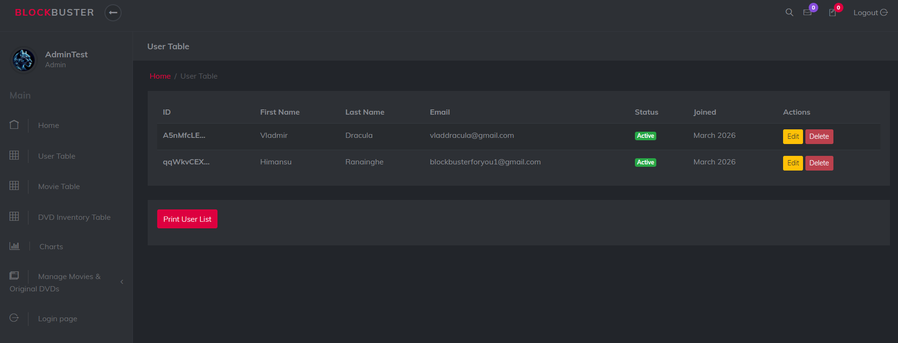
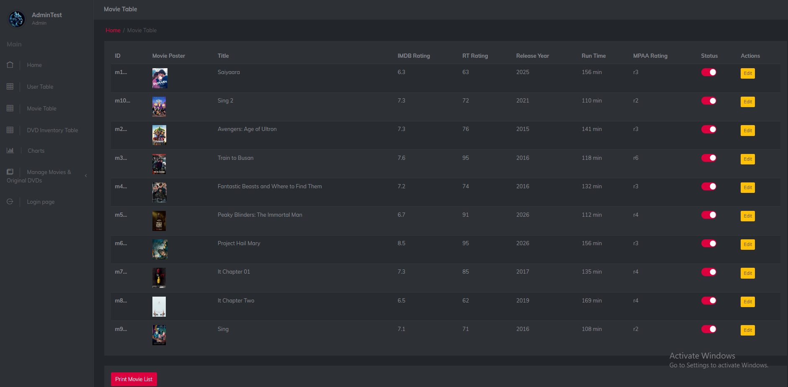

<h1 align="center">🎬 BlockBuster - Full-Stack DVD Store</h1>

  
  
  
  
  

  <strong>BlockBuster</strong> is a complete e-commerce ecosystem for purchasing DVDs. It features a native Android mobile app for customers and a custom web-based Admin Panel for store management, both powered by a unified Firebase backend.

---

## 📖 Overview

This project consists of two integrated parts:
1. **Android Mobile App:** A Java-based shopping application where users can browse movies, manage a cart, place orders via PayHere, and manage their profiles.
2. **Admin Web Panel:** A vanilla HTML/JS dashboard built for store administrators to manage inventory, users, movies, and view real-time sales analytics.

Both applications communicate directly with Cloud Firestore, Firebase Storage, and Firebase Authentication to ensure real-time data sync across the platform.

## ✨ Key Features

### 📱 Customer Android App
- **Authentication & Profiles:** Email/password login, profile updates, and image uploads via Firebase Storage.
- **Dynamic Catalog:** Browse movies by genre, view top-selling DVDs, new arrivals, and recommendations (ranked by IMDb/Rotten Tomatoes).
- **Shopping Cart & Checkout:** Firestore-backed cart, shipping/billing address capture, and secure checkout integration with the PayHere Sandbox SDK.
- **Stock Management:** Atomic Firestore transactions deduct DVD stock in real-time upon successful payment.
- **Extras:** Dark/Light theme toggle, Lottie splash screen, Google Maps store locator, and YouTube trailer intents.

### 💻 Admin Web Panel
- **Analytics Dashboard:** Real-time tracking of total users, daily revenue, DVD sales, and recent user activities.
- **Inventory Management:** Full CRUD operations for DVDs, including stock, price, and status toggles.
- **Catalog Management:** Manage movies, actors, directors, genres, and upload associated media.
- **User Management:** View, edit, print, and delete user accounts.

## 🛠️ Technology Stack

| Category | Technologies |
| :--- | :--- |
| **Mobile App** | Java 11, Android SDK 36, XML Layouts, ViewBinding, Glide, Lottie, PayHere SDK |
| **Admin Panel** | HTML5, CSS3, Vanilla JS, Bootstrap, jQuery, Firebase SDK v10 |
| **Backend & DB** | Firebase (Authentication, Cloud Firestore, Storage, Analytics) |
| **Integrations** | Google Maps API, PayHere Payment Gateway, YouTube Player |

## 📸 System Showcase

### 📱 Android App
| Home Screen | Movie Details | Shopping Cart | Checkout |
| :---: | :---: | :---: | :---: |
|  |  |  |  |

### 💻 Admin Panel
| Dashboard Analytics | DVD Inventory | User Management | Movie Management |
| :---: | :---: | :---: | :---: |
|  |  |  |  |

## 🗄️ Database & Data Models

The ecosystem utilizes **Cloud Firestore** as the primary NoSQL database, with data synchronized in real-time between the Android app and Admin panel.

- **`users`**: Customer profiles (Subcollection: `cart`)
- **`movies`** / **`dvds`**: Movie metadata, cast IDs, and physical DVD inventory (stock, price).
- **`orders`**: Transaction history including `OrderItem` and `Address` objects.
- **`actors`** / **`directors`** / **`genres`**: Reference data for catalog management.
- **`admin`**: Custom collection used for web-panel authentication.

## 🏗️ Architecture

1. **Client Layer (Android):** Traditional Activity/Fragment architecture using ViewBinding. Directly queries Firebase SDKs.
2. **Client Layer (Admin):** Static multi-page app using browser-loaded ES modules to communicate directly with Firebase.
3. **Backend-as-a-Service (Firebase):** Firestore handles atomic transactions (e.g., stock deduction during checkout), while Firebase Storage handles all image hosting.

## 🚀 Future Enhancements & Known Issues

*(Note: These are identified improvements to transition the project to a production-ready enterprise standard).*
- [ ] **Security:** Move PayHere merchant secrets to a secure backend server (currently embedded in the Android client).
- [ ] **Security:** Migrate Admin Panel authentication from `sessionStorage` to Firebase Auth with custom claims.
- [ ] **Security:** Implement strict Firestore Security Rules to prevent unauthorized writes to orders and user data.
- [ ] **Features:** Complete the placeholder Wishlist and Messaging fragments in the Android app.
- [ ] **Architecture:** Migrate the Android app to MVVM using Jetpack ViewModels.

## 👨‍💻 Author

**Himansu Nethsara Ranasinghe**
- 🎓 BSc (Hons) Software Engineering Undergraduate (JIAT / BCU)
- 🔗 [LinkedIn](https://www.linkedin.com/in/himansu-nethsara/)
- 🐙 [GitHub](https://github.com/HimansuNethsara)